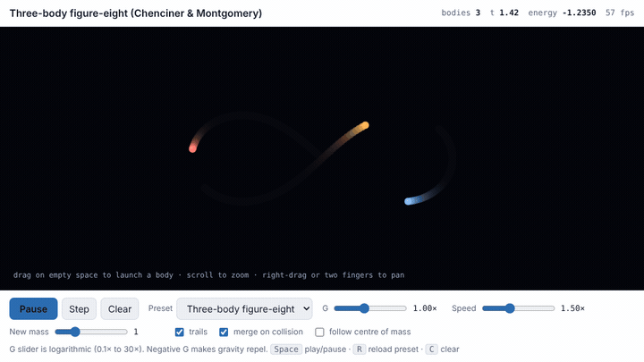
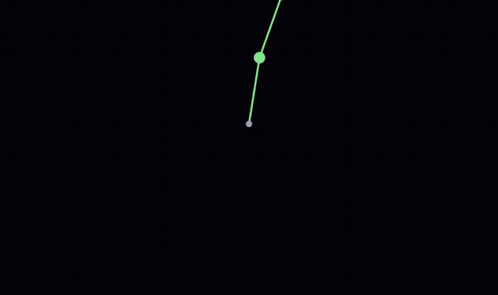
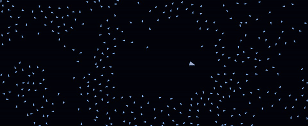
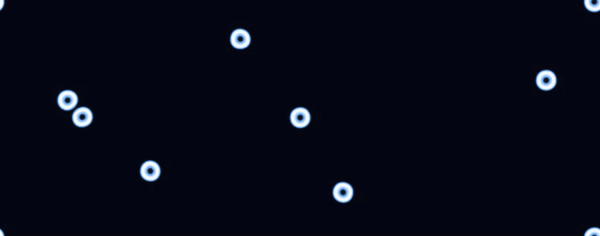
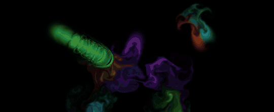
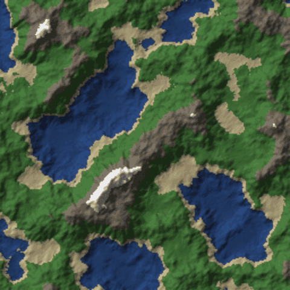
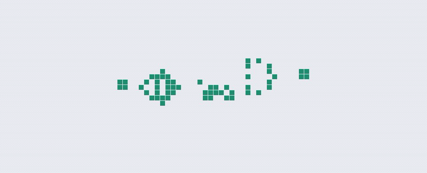
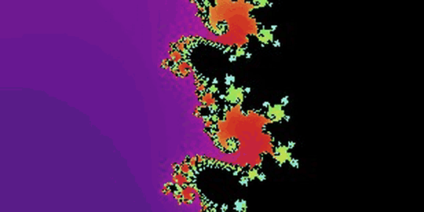

# simulations

Eight physics and math simulations, each a single HTML file with no build step and no dependencies. Open any `index.html` in a browser, or run them live at [apps.x9m8.com](https://apps.x9m8.com/).

Every simulation accepts URL parameters so a particular state can be linked or embedded. Each one has a short note below on the math it runs and a longer article on [x9m8.com](https://x9m8.com/).

| Simulation | Live | Method |
|---|---|---|
| [Gravity Lab](#gravity-lab) | [apps.x9m8.com/gravity-lab](https://apps.x9m8.com/gravity-lab/) | Velocity Verlet, Barnes–Hut |
| [Double Pendulum](#double-pendulum) | [apps.x9m8.com/double-pendulum](https://apps.x9m8.com/double-pendulum/) | RK4, Lyapunov estimate |
| [Flocking](#flocking) | [apps.x9m8.com/flocking](https://apps.x9m8.com/flocking/) | Boids, spatial hash |
| [Reaction–Diffusion](#reactiondiffusion) | [apps.x9m8.com/reaction-diffusion](https://apps.x9m8.com/reaction-diffusion/) | Gray–Scott on the GPU |
| [Fluid](#fluid) | [apps.x9m8.com/fluid](https://apps.x9m8.com/fluid/) | Stable Fluids, WebGL |
| [Erosion](#erosion) | [apps.x9m8.com/erosion](https://apps.x9m8.com/erosion/) | Particle hydraulic erosion |
| [Cellular Automata](#cellular-automata) | [apps.x9m8.com/cellular-automata](https://apps.x9m8.com/cellular-automata/) | Life-like and elementary rules |
| [Mandelbrot](#mandelbrot) | [apps.x9m8.com/mandalbrot](https://apps.x9m8.com/mandalbrot/) | Escape-time with smooth colouring |

---

## Gravity Lab



An N-body gravity simulator. Presets: `solar`, `binary`, `figure8`, `cluster`, `galaxy`, `moon`, `empty`. Click to add bodies, drag to give them velocity.

`?preset=figure8&speed=1.5&trails=1`

**The math.** Each body feels the Newtonian pull of every other, `a_i = Σ G m_j (r_j − r_i) / (|r_j − r_i|² + ε²)^{3/2}`, with a small softening `ε` so close passes don't blow up. Positions advance with velocity Verlet: half-kick, drift, recompute forces, half-kick. Verlet is symplectic, so it conserves energy over long runs instead of letting orbits spiral in or out the way Euler does. The direct sum costs O(N²); above 300 bodies the simulator switches to a Barnes–Hut quadtree, which treats distant clumps of mass as single points when the cell's size over its distance falls below an opening angle θ = 0.6, bringing the cost to O(N log N). The figure-eight preset is the Chenciner–Montgomery choreography, three equal masses chasing each other round a single lemniscate; it is one of the few known stable three-body solutions and sits a hair's breadth from chaos, so small numerical drift eventually breaks it.

Article: [Gravity Lab: an N-body simulator and the three-body figure-eight](https://x9m8.com/gravity-lab-n-body-simulator-three-body-figure-eight/)

## Double Pendulum



Two rods, two masses, and sensitivity to initial conditions you can watch. Run three copies that differ by 10⁻⁴ radians and see them separate.

`?start=high&three=1&delta=-4`

**The math.** The state is `(θ₁, ω₁, θ₂, ω₂)`. The Lagrangian `L = T − V` gives two coupled second-order equations that are solved for the angular accelerations each step; the denominators carry a `2m₁ + m₂ − m₂ cos(2θ₁ − 2θ₂)` term that couples the rods. Integration is classical fourth-order Runge–Kutta with a fixed step of 1/2000 s, small enough that the energy readout barely drifts over a long run. The simulator also runs a shadow trajectory offset by `δ` and tracks `ln(|Δ(t)| / |Δ(0)|) / t`, a crude running estimate of the largest Lyapunov exponent. For high-energy starts it settles near 1–2 per second, meaning the separation grows by a factor of e every half-second or so. That number is the whole story of why a double pendulum can't be predicted past a few seconds.

Article: [Double Pendulum Chaos: a simulator and the Lyapunov exponent](https://x9m8.com/double-pendulum-chaos-simulator-lyapunov/)

## Flocking



Reynolds boids with an optional predator. Up to 4,000 agents.

`?n=1500&trails=1&predator=0`

**The math.** Each boid steers by three local rules over its neighbours within a vision radius: separation (push away from anything too close, weighted by 1/distance), alignment (match the average heading), cohesion (move toward the average position). The three steering vectors are scaled by their sliders, summed, clamped to a maximum force, and applied as acceleration; speed is clamped so the flock neither stalls nor explodes. The naive neighbour search is O(N²). The simulator drops each boid into a uniform grid whose cell size equals the vision radius, so a boid only tests the nine cells around it, which is O(N) on average and is what keeps a few thousand boids interactive in plain JavaScript. The predator is a boid that ignores the rules and chases the nearest prey; prey add a fourth, strongly weighted flee vector when it comes within range.

Article: <https://x9m8.com/flocking-simulation-boids-starling-murmuration/>

## Reaction–Diffusion



Gray–Scott patterns on the GPU. Presets: `coral`, `mitosis`, `spots`, `stripes`, `moving`, `holes`, `chaos`, `solitons`, or set `f` and `k` directly. Paint with the mouse.

`?preset=mitosis` · `?f=0.030&k=0.062&palette=2`

**The math.** Two chemicals, A and B, on a grid. A is fed in at rate `f`, B is removed at rate `f + k`, and the reaction `A + 2B → 3B` converts one into the other:

```
∂A/∂t = D_A ∇²A − A·B² + f (1 − A)
∂B/∂t = D_B ∇²B + A·B² − (f + k) B
```

with `D_A = 1.0`, `D_B = 0.5`. The Laplacian is a 3×3 stencil (centre −1, edges 0.2, corners 0.05) evaluated in a fragment shader; two floating-point textures ping-pong so each pass reads the previous state and writes the next. Several passes run per frame. The whole pattern zoo, spots, stripes, dividing cells, comes from where `(f, k)` sits on Pearson's map; only a thin band of that plane produces anything but uniform grey.

Article: <https://x9m8.com/reaction-diffusion-simulator-turing-patterns-gray-scott/>

## Fluid



Incompressible 2D fluid you can stir. Views: dye, velocity, vorticity, pressure.

`?view=2&splats=0`

**The math.** Jos Stam's Stable Fluids, in WebGL. Each frame: advect velocity through itself (semi-Lagrangian, trace each cell back along the flow and sample there, unconditionally stable), diffuse with a few Jacobi iterations when viscosity is nonzero, add forces from the mouse and from vorticity confinement, then project. Projection is the part that makes it a fluid: solve the Poisson equation `∇²p = ∇·u` for pressure with Jacobi iterations, then subtract `∇p` from the velocity so the field becomes divergence-free. Dye is a separate scalar field advected by the final velocity. Vorticity confinement computes the curl `ω = ∂v/∂x − ∂u/∂y`, takes the normalised gradient of `|ω|`, and pushes the flow along `N × ω` to put back the small swirls that semi-Lagrangian advection smears away.

Article: <https://x9m8.com/fluid-simulator-navier-stokes-stable-fluids-browser/>

## Erosion



Rain carving a fractal-noise terrain into valleys and ridges. Views: shaded relief, raw height, sediment moved.

`?seed=7&view=0`

**The math.** The terrain starts as several octaves of Perlin noise. Erosion is particle-based, after Hans Beyer's 2015 thesis: each raindrop lands at random, reads the local gradient from bilinear interpolation of the four surrounding cells, and updates its direction as a blend of its previous heading (inertia) and the downhill direction. It moves one cell, and the height difference `Δh` decides what happens. Its carrying capacity is `c = max(−Δh, p_min) · speed · water · c_factor`. Carrying less than that, it erodes up to `(c − sediment) · k_erode` from the cells around it, spread by a radius kernel; carrying more, it deposits `(sediment − c) · k_deposit`. Speed updates from `v² = v² + Δh · g`, water evaporates by a fraction each step, and the drop dies after a fixed lifetime or when it stops. A few hundred thousand drops turn the noise into drainage networks.

Article: <https://x9m8.com/erosion-simulator-hydraulic-erosion-terrain-rain/>

## Cellular Automata



Conway's Life, HighLife, Day & Night, Seeds, Brian's Brain, Maze, and all 256 elementary rules. Patterns: `glider`, `rpent`, `pulsar`, `gun`, `acorn`, `diehard`, `center`.

`?rule=life&pattern=gun&speed=15&cell=6` · `?rule=elem&elem=110`

**The math.** A Life-like rule is written `B.../S...`: a dead cell is born with the listed neighbour counts, a live cell survives with the listed counts, and everything else dies. Life is `B3/S23`. The simulator counts the eight Moore neighbours on a toroidal grid (or a bounded one with `wrap=0`) and applies the rule to every cell at once, double-buffered so updates don't bleed into each other. Elementary automata are one-dimensional: each cell's next state depends on itself and its two neighbours, so there are 2³ = 8 cases and 2⁸ = 256 rules, numbered by Wolfram's scheme. Rule 30 is chaotic and was used as a random number generator; rule 110 is Turing complete. The Gosper gun pattern is the first found that grows without bound, emitting a glider every 30 generations.

Article: [Cellular Automata: Game of Life, Rule 30 and Rule 110 simulator](https://x9m8.com/cellular-automata-game-of-life-rule-30-rule-110-simulator/)

## Mandelbrot



A zoomable Mandelbrot explorer with an auto-pilot that dives into the boundary.

**The math.** For each pixel, take its complex coordinate `c` and iterate `z ← z² + c` from `z = 0`. If `|z|` ever exceeds 2 the orbit escapes to infinity and `c` is outside the set; the set itself is the points that never escape. The explorer counts iterations up to a cap (128 by default, adjustable) and maps the count to one of several colour schemes; points that reach the cap are painted black. Deep zooms need a higher cap because points near the boundary take longer to decide, so the iteration slider is the control to reach for when a zoom turns to mush. The boundary has Hausdorff dimension 2, which is why there is always more detail: every zoom reveals miniature copies of the whole set, connected to the main body by filaments, each surrounded by its own spirals.

Article: [Mandelbrot Set Explorer: a zoomable fractal browser](https://x9m8.com/mandelbrot-set-explorer-zoom-fractal-browser/)

---

## Embedding

Each simulation is designed to be dropped into an iframe:

```html
<iframe src="https://apps.x9m8.com/gravity-lab/?preset=galaxy" width="100%" height="620" loading="lazy"></iframe>
```

## License

MIT. See [LICENSE](LICENSE).
